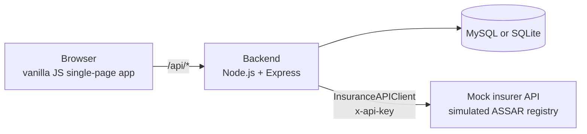

# SureTrace

**Vehicle insurance history for Rwanda.** Buyers check any plate number in seconds. Sellers get one verified, QR-checked report covering every motor insurer, ready for the RRA ownership transfer, without visiting insurance offices one by one.

| | |
|---|---|
| **Live demo** | https://suretrace-demo.onrender.com|
| **Demo video** | _add the video link here_ |
| **SRS document** | https://docs.google.com/document/d/14Mqt1RaMflnV0NA8hw_eyd62wlFYANJwBwdjSkU8C1w/edit?usp=sharing |
| **Repository** | https://github.com/Umukundwaa/suretrace |

> **Data notice:** no public Rwandan insurer or ASSAR API exists yet, so insurer records come from a separate **mock insurer API** that simulates it. It returns the same structure a real feed would, and the backend talks to it through a single client file, so it can be swapped for a real API later.
---

## Table of contents
1. [The problem and the solution](#1-the-problem-and-the-solution)
2. [Who uses it](#2-who-uses-it)
3. [Features and SRS requirements](#3-features-and-srs-requirements)
4. [Architecture and tech stack](#4-architecture-and-tech-stack)
5. [Setup: run it on your computer](#5-setup-run-it-on-your-computer)
6. [Demo accounts and test data](#6-demo-accounts-and-test-data)
7. [Quick tour: how to check each feature](#7-quick-tour-how-to-check-each-feature)
8. [Running the automated tests](#8-running-the-automated-tests)
9. [Deploying to Render (free)](#9-deploying-to-render-free)
10. [Configuration reference](#10-configuration-reference)
11. [API reference](#11-api-reference)
12. [Project structure](#12-project-structure)
13. [Security notes](#13-security-notes)
14. [Known limitations](#14-known-limitations)
15. [Git workflow](#15-git-workflow)
16. [Author](#16-author)

---

## 1. The problem and the solution

**Problem.** Before a vehicle can be sold and transferred at RRA, the seller must prove its insurance history. Today that means visiting every insurer, one by one, to ask for a certificate, including insurers the seller never had a policy with. It costs days. Buyers, meanwhile, have no quick way to confirm that a vehicle is insured right now.

**Solution.** SureTrace searches all insurers at once.
- A **buyer** types a plate number and sees whether the vehicle is currently insured, with which insurer and until when. No account needed.
- A **seller** signs up with their National ID, adds their own vehicle, and gets the full history across all 9 insurers (insurers with no record are listed too), a coverage timeline that highlights uninsured gaps, certificate details, and a downloadable PDF with a QR code that anyone can scan to confirm it is genuine.

## 2. Who uses it

| Actor | Needs login? | Can do |
|---|---|---|
| **Buyer** | No | Search a plate and see current insurance status and insurer |
| **Seller** | Yes (National ID + password) | Everything above, plus: own vehicles, full multi-insurer history, certificate view/download, search history, profile and password |
| **Insurer registry** (external system) | API key | Supplies vehicles, owners and certificates (simulated by the mock API) |

## 3. Features and SRS requirements

Each row is a requirement from the SRS (Assignment 1), where it lives in the code, and how it is verified. "Auto" means an automated test in `backend/test/api.test.js`; "Manual" means it was checked in a browser.

### Functional requirements

| ID | Requirement | Implemented in | Verified |
|---|---|---|---|
| FR 1.1 | Seller registers with National ID, name, phone, password | `controllers/auth.js` `register`, `/register` page | Auto + Manual |
| FR 1.2 | National ID must match a registered vehicle owner **before** the account is created | `register` calls the registry (`services/insuranceApiClient.js` `fetchOwner`); refused with `not_registered_owner` | Auto + Manual |
| FR 2.1 | Login with National ID and password | `auth.js` `login`, JWT session | Auto + Manual |
| FR 2.2 | Passwords hashed before storage | bcrypt (`bcryptjs`, cost 10) | Auto (login works only with the right password) |
| FR 3.1 | Anyone can search by plate, no login | `GET /api/search/:plate` | Auto + Manual |
| FR 3.2 | Show current insurance status and insurer | `services/historyService.js` `quickStatus` | Auto + Manual |
| FR 4.1 | Logged-in seller retrieves full history across multiple providers | `GET /api/seller/vehicles/:plate/history` (all 9 insurers) | Auto + Manual |
| FR 4.2 | Show insurer name, policy number, coverage period per certificate | History page and `GET /api/seller/certificates/:no` | Auto + Manual |
| FR 5.1 | View full certificate details | `/cert/:no` page | Manual |
| FR 5.2 | Download certificate / history for RRA transfer | `GET .../history.pdf` and `.../certificates/:no/pdf` (PDF with QR) | Auto + Manual |
| FR 6.1 | Log and show the seller's past searches with date and plate | `search_logs` table, dashboard "Recent searches" | Auto + Manual |
| FR 7.1 | View and update profile | `GET/PUT /api/seller/profile`, `PUT /api/seller/password`, `/settings` page | Auto + Manual |
| FR 7.2 | Logout | Header "Log out" | Manual |

### Non-functional requirements

| ID | Requirement | How it is met | Verified |
|---|---|---|---|
| NFR 1 | Passwords encrypted before storage | bcrypt hashes only; no plain text stored | Code review |
| NFR 2 | HTTPS for client-server traffic | Render serves the live site over HTTPS; production mode requires a strong `JWT_SECRET` | On the live URL |
| NFR 3 | Search results within 5 seconds | Responses measured at roughly 0.01-0.2 s locally | Auto (asserts under 5 s) |
| NFR 4 | English and Kinyarwanda interface | Full EN / RW (and FR) translations, switchable anywhere | Manual |
| NFR 5 | New user can do a buyer search without help | Plate search is on the home page, formats the plate as you type, has demo plates to click | Manual |
| NFR 6 | 99% uptime in test/demo phase | `/health` endpoint for monitoring; see [Known limitations](#14-known-limitations) for the free-tier caveat | `/health` |
| NFR 7 | Works on desktop, tablet and mobile browsers | Responsive layout, checked from 320 px wide up in all languages | Manual |
| NFR 8 | Log all account logins and search actions | `login_logs` (sign-ups, logins, failed logins) and `search_logs`; seller sees own activity in Settings | Auto + Manual |

### Extra features beyond the SRS
Coverage **timeline** showing uninsured gaps; **QR verification** pages (`/verify/...`) for reports and certificates; **French** as a third language; light/dark theme; password change.

## 4. Architecture and tech stack



| Layer | Technology |
|---|---|
| Frontend | HTML, CSS, vanilla JavaScript (no build step), served by the backend; EN / FR / RW |
| Backend | Node.js 22, Express, `bcryptjs`, `jsonwebtoken`, `helmet`, `express-rate-limit`, `pdfkit`, `qrcode` |
| Database | MySQL (production) or SQLite (built into Node 22, zero setup) |
| External data | Separate Express service that simulates insurers and the vehicle registry |
| Tests | Node's built-in test runner (`node --test`) |

Database tables: `sellers`, `vehicles`, `insurance_certificates` (cached copy of what the registry returned), `search_logs`, `login_logs`, `history_reports` (issued PDFs, used by QR verification).

## 5. Setup: run it on your computer

### Prerequisites
- **Node.js 22.13 or newer** (check with `node -v`; download the LTS from https://nodejs.org)
- **Git** (check with `git --version`)
- MySQL is **optional** (only for Option B)

### Option A: fastest way (SQLite, demo data included). Recommended.

Run these in a terminal (Git Bash on Windows, Terminal on macOS/Linux):

```bash
# 1. Get the code
git clone https://github.com/Umukundwaa/suretrace.git
cd suretrace

# 2. Install dependencies for both services
npm run install:all

# 3. Start everything (mock insurer API + demo data + website)
npm start
```

Step 3 should print the lines below. Leave the terminal open.

```
mock-insurer-api listening on :4001
Demo seller accounts are ready: ...
SureTrace backend on http://localhost:4000 (db: sqlite)
```

4. Open **http://localhost:4000** in your browser.
5. Stop with `Ctrl + C`.

No `.env` file is needed for this option. Demo data is created automatically; see [Demo accounts](#6-demo-accounts-and-test-data).

### Option B: with MySQL

1. Make sure MySQL is running and you know your user and password.
2. Install dependencies: `npm run install:all`
3. Create the settings file and edit it:
   ```bash
   cp backend/.env.example backend/.env
   ```
   Open `backend/.env` and set `DB_CLIENT=mysql`, `DB_USER`, `DB_PASSWORD`, and a long random `JWT_SECRET`. The database and tables are created automatically on first start.
4. Start the mock insurer API in **terminal 1**:
   ```bash
   cd mock-insurer-api
   npm start            # listens on :4001
   ```
5. Start the backend in **terminal 2**:
   ```bash
   cd backend
   npm start            # listens on :4000
   ```
6. Open http://localhost:4000. In this mode no demo accounts are pre-created: register using one of the [owner National IDs](#6-demo-accounts-and-test-data).

### Troubleshooting
| Symptom | Fix |
|---|---|
| `Cannot find module 'node:sqlite'` or similar | Node is too old. Install Node 22.13+ |
| Page loads but searches fail | The mock insurer API is not running (Option B: start terminal 1) |
| `EADDRINUSE` / port already in use | Another program uses 4000 or 4001. Stop it, or set `PORT=4100` before starting |
| `JWT_SECRET must be at least 32 characters in production` | Only in production mode: set a long `JWT_SECRET` |
| MySQL `Access denied` | Wrong `DB_USER` or `DB_PASSWORD` in `backend/.env` |

## 6. Demo accounts and test data

The insurer data is simulated. These are the vehicles and owners that exist in the mock registry.

| Plate | Vehicle | Owner (National ID) | What it demonstrates |
|---|---|---|---|
| **RAD 123 A** | Toyota RAV4 | Ange Umukundwa (`1199880012345678`) | Currently insured (SONARWA), past SORAS cover, **two uninsured gaps** |
| **RAC 902 B** | Honda CR-V | Ange Umukundwa (`1199880012345678`) | **Expired** cover (Radiant, then SONARWA) |
| **RAB 555 C** | Toyota Hiace (public service) | Jean Claude Habimana (`1198570098765432`) | Active cover with BK General and Britam history |
| **RAF 777 E** | Nissan X-Trail | Eric Niyonsenga (`1199680044433322`) | Active (Mayfair) after Britam; owner is **not pre-registered**, so use it to test sign-up |
| **RAE 310 D** | Suzuki Swift | Grace Mukamana (`1199270055511122`) | **Never insured**: "No record" |

**Ready-made seller accounts** (created automatically by `npm start` / the Render deployment). Password for all: `Demo1234`

| National ID | Name |
|---|---|
| `1199880012345678` | Ange Umukundwa (owns RAD 123 A, RAC 902 B) |
| `1198570098765432` | Jean Claude Habimana (owns RAB 555 C) |
| `1199270055511122` | Grace Mukamana (owns RAE 310 D) |

**To test sign-up:** register with National ID `1199680044433322` (any name, any password of 8+ characters), then add vehicle `RAF 777 E`. A National ID that owns no registered vehicle, such as `1111111111111111`, is refused (this is requirement FR 1.2).

"Current" demo policies are dated relative to today, so the demo plates stay **Active** whenever you run the project.

## 7. Quick tour: how to check each feature

1. **Buyer search (no login):** on the home page click the demo plate chip `RAD 123 A` (or type it). You see *Active coverage*, the insurer, policy number and dates. Try `RAC 902 B` (Expired) and `RAE 310 D` (No record). Type `XYZ` to see the validation message.
2. **Sign-up with ownership check:** go to *Get started*. Try National ID `1111111111111111` (refused). Then use `1199680044433322` (accepted).
3. **Login:** use `1199880012345678` / `Demo1234`. A wrong password shows an error.
4. **Seller history:** open the vehicle **RAD 123 A**. You see all 9 insurers, the coverage timeline with the two red uninsured gaps, and the insurers with no record.
5. **Certificate:** click any certificate row to see its full details and QR code.
6. **Download:** use *Download full history (PDF)* and *Download certificate (PDF)*.
7. **Verify with the QR code:** scan the QR in a downloaded PDF, or open `/verify/cert/SNR-CI-204821` style links, to see the public verification page (shows no personal data).
8. **Search history:** do a search while logged in, then check *Recent searches* on the dashboard (plate and date).
9. **Profile:** open *Settings*, change the phone number, save, reload. Change the password. See *Recent account activity* (logins and failed logins).
10. **Languages:** switch EN / FR / RW from the header.
11. **Mobile:** narrow the browser window or open the site on a phone.
12. **Logout:** use *Log out* in the header.

## 8. Running the automated tests

```bash
npm test
```

The suite starts its own copy of the mock API and backend on a temporary SQLite database (no setup, no leftover data) and runs 17 tests: search states, input validation, ownership verification (FR 1.2), duplicate and wrong-password handling, token protection, vehicle claiming, the 9-insurer history and gap detection, owner-only access, PDF downloads, QR verification, search and login audit logs, profile updates and the 5-second response limit.

## 9. Deploying to Render (free)

The repository includes `render.yaml`, which describes the whole deployment. It runs the website, the mock insurer API and demo data in **one** free web service using SQLite.

1. Push this repository to GitHub (it must contain `render.yaml` at the top level).
2. Create a free account at https://render.com and sign in with GitHub.
3. Click **New +** → **Blueprint**, choose the `suretrace` repository, and click **Apply**.
4. Wait for the first build to finish (a few minutes). Render generates the `JWT_SECRET` and `INSURER_API_KEY` for you.
5. Open the URL Render shows (like `https://suretrace-demo.onrender.com`). Check `/health` returns `{"ok":true}`.
6. Optional: set `PUBLIC_BASE_URL` to that URL so QR codes inside PDFs point to the live site, then redeploy.

Notes: Render's free web service sleeps after about 15 minutes without traffic (the next visit takes up to a minute to wake it) and the SQLite file lives in temporary storage, so data resets when the service restarts. Demo accounts are re-created automatically on every start. For permanent data, use a MySQL-compatible database and `DB_CLIENT=mysql`.

## 10. Configuration reference

Set as environment variables or in `backend/.env` (copy from `backend/.env.example`).

| Variable | Default | Purpose |
|---|---|---|
| `PORT` | `4000` | Backend/website port |
| `JWT_SECRET` | dev-only value | Signs login tokens. **Required, 32+ chars, in production** |
| `JWT_EXPIRES_IN` | `2h` | Session length |
| `PUBLIC_BASE_URL` | `http://localhost:4000` | Used in QR codes inside PDFs |
| `DB_CLIENT` | `mysql` | `mysql` or `sqlite` (`npm start` forces `sqlite`) |
| `DB_HOST`, `DB_PORT`, `DB_USER`, `DB_PASSWORD`, `DB_NAME` | localhost, 3306, root, empty, suretrace | MySQL connection |
| `SQLITE_FILE` | `./suretrace.sqlite` | SQLite file path |
| `INSURER_API_URL` | `http://localhost:4001` | Where the insurer/registry API lives |
| `INSURER_API_KEY` | `dev-insurer-key` | Sent as `x-api-key` to the insurer API |
| `DEMO_MODE` | `true` | Shows the "simulated data" notice; set `false` with real data |

## 11. API reference

All paths start with `/api`. "Seller" routes need the header `Authorization: Bearer <token>` from login.

| Method and path | Auth | Purpose |
|---|---|---|
| `GET /config` | none | Public settings (demo mode) |
| `POST /auth/register` | none | Create seller account (checks vehicle ownership) |
| `POST /auth/login` | none | Log in, returns a token |
| `GET /search/:plate` | none | Buyer status check |
| `GET /verify/:ref`, `GET /verify/cert/:no` | none | QR verification (no personal data) |
| `GET /qr/cert/:no.png` | none | QR image |
| `GET, POST /seller/vehicles` | seller | List / add own vehicle |
| `GET /seller/vehicles/:plate/history` | seller | Full history across all insurers |
| `GET /seller/vehicles/:plate/history.pdf` | seller | History report PDF |
| `GET /seller/certificates/:no` and `/pdf` | seller | Certificate details / PDF |
| `GET /seller/searches` | seller | Own search history |
| `GET, PUT /seller/profile` | seller | View / update profile |
| `PUT /seller/password` | seller | Change password |
| `GET /seller/activity` | seller | Own recent sign-ins |
| `GET /health` (no `/api`) | none | Health check |

## 12. Project structure

```
suretrace/
├── package.json            Root scripts: install:all, start, test
├── render.yaml             Render deployment blueprint
├── backend/
│   ├── src/                config/, controllers/, middleware/, routes/, services/, utils/, server.js
│   ├── public/             Website: index.html, styles.css, app.js, i18n.js, i18n2.js
│   ├── sql/                schema.mysql.sql, schema.sqlite.sql
│   ├── scripts/            start-demo.js (one-command start), seed-demo.js (demo accounts)
│   └── test/               api.test.js (automated tests)
└── mock-insurer-api/
    └── src/                server.js (simulated registry API), data.js (vehicles, certificates)
```

## 13. Security notes

- Passwords are hashed with bcrypt; login gives the same error for an unknown ID and a wrong password.
- JWT sessions expire after 2 hours; production refuses to start with a weak `JWT_SECRET`.
- Login, registration and search endpoints are rate-limited; security headers via Helmet.
- Every seller route checks that the vehicle or certificate belongs to the signed-in seller.
- Buyers receive only status, insurer, policy number and dates, never personal data.
- The audit log stores only the last 4 digits of the National ID for failed attempts.
- `.env` and database files are git-ignored; never commit real secrets.

## 14. Known limitations

- **Simulated data.** Insurer records come from the mock API, not real insurers. A real data-sharing agreement or API would be needed for production.
- **Free hosting.** The Render free service sleeps when idle and resets its SQLite data on restart, so the 99% uptime target (NFR 6) is a goal, not a guarantee, on the free tier.
- **Translations.** French and Kinyarwanda texts are first drafts and should be reviewed by native speakers.
- **Scope.** Accident and theft history, SMS/OTP verification and an administrator role were deliberately left out of this version.

## 15. Git workflow

- `main` is the stable branch. Work is done on short-lived feature branches (for example `feat/authentication`, `feat/frontend-ui`, `docs/readme-and-docs`) and merged through pull requests.
- Commit messages follow `type(scope): summary` (`feat`, `fix`, `test`, `docs`, `chore`).

## 16. Author

Built by **Ange Umukundwa**, Software Engineering, African Leadership University, Kigali, Rwanda.
